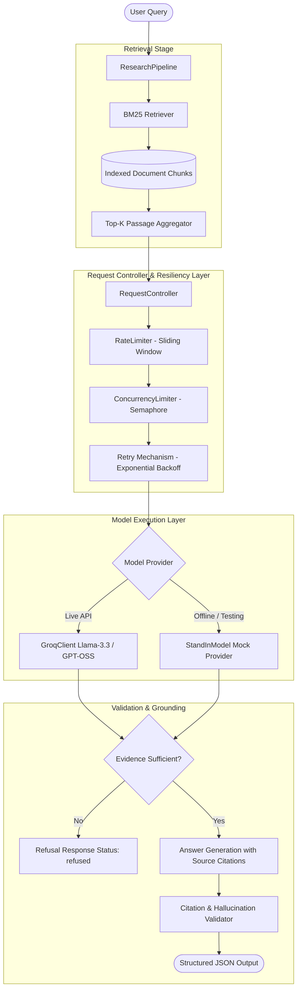
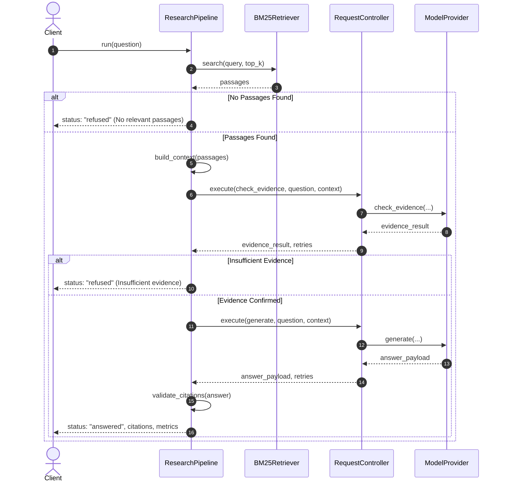

# Relay: Resilient RAG and LLM Control Pipeline

Relay is a production-grade, fault-tolerant Retrieval-Augmented Generation (RAG) pipeline designed for academic literature question answering. It integrates document ingestion, BM25-based information retrieval, two-stage evidence verification with generation, and resilient traffic control mechanisms (rate limiting, bounded concurrency, and exponential backoff retry policies).

---

## Architectural Overview

Relay decouples retrieval, traffic control, and model invocation. The system routes incoming queries through an indexed corpus of research papers, validates retrieval relevance through an evidence filter, and coordinates LLM calls through a centralized request controller.



---

## System Component Breakdown

### 1. Document Ingestion and Chunking (`app/retrieval/`)
- **Ingestion (`ingestion.py`)**: Parses PDF research papers (such as Attention Is All You Need, Moshi, and Dynamic Chunking) and extracts raw text page-by-page.
- **Chunking (`chunking.py`)**: Divides document text into overlapping token windows to preserve inter-sentence context across segment boundaries.
- **Retriever (`bm25_retriever.py`)**: Builds an in-memory Okapi BM25 inverted index across chunks for fast lexical retrieval.

### 2. Traffic Control and Resiliency (`app/control/`)
- **Request Controller (`request_controller.py`)**: Unified entrypoint wrapping remote model invocations.
- **Rate Limiter (`rate_limiter.py`)**: Thread-safe sliding-window limiter enforcing client-side maximum request frequencies (e.g., 25 requests per 60 seconds).
- **Concurrency Limiter (`concurrency.py`)**: Thread-safe bounded semaphore restricting parallel in-flight network requests to upstream endpoints.
- **Retry Logic (`retry.py`)**: Exponential backoff algorithm capturing transient network failures (`429`, `500`, `502`, `503`, `504`, timeouts, connection drops) with configurable maximum attempts and jitter delays.

### 3. Model Providers (`app/providers/` and `standin/`)
- **Model Provider Interface (`base.py`)**: Abstract `runtime_checkable` protocol establishing standardized contracts for `generate()` and `check_evidence()`.
- **Groq Client (`groq_client.py`)**: Integration client interfacing with the Groq Chat Completions API.
- **Stand-In Simulator (`standin/model.py`)**: Standalone deterministic simulator capable of mimicking model response latencies, synthetic rate limits (429 errors), intermittent server errors (500 errors), and query refusal decisions without incurring external API costs.

### 4. End-to-End Orchestrator (`app/pipeline/`)
- **Research Pipeline (`research_pipeline.py`)**: Orchestrates the multi-step lifecycle:
  1. Lexical retrieval of top-K chunks.
  2. Synthesizing context with unique citation tags (`[S1]`, `[S2]`, ...).
  3. Evidence verification gate through `check_evidence()`.
  4. Answer generation with citation constraints.
  5. Deterministic validation verifying all cited source keys exist in retrieved context.

---

## Pipeline Execution Flow



---

## Project Structure

```
Relay/
├── app/
│   ├── control/
│   │   ├── concurrency.py         # Thread-safe concurrency semaphore
│   │   ├── rate_limiter.py        # Sliding-window rate limiter
│   │   ├── request_controller.py  # Central resilient execution coordinator
│   │   └── retry.py               # Exponential backoff retry handler
│   ├── pipeline/
│   │   └── research_pipeline.py   # Complete multi-stage RAG orchestrator
│   ├── providers/
│   │   ├── base.py                # ModelProvider typing protocol
│   │   └── groq_client.py         # Production Groq API implementation
│   └── retrieval/
│       ├── bm25_retriever.py      # Okapi BM25 search engine
│       ├── chunking.py            # Overlapping chunk generator
│       └── ingestion.py           # Document extraction loader
├── data/
│   ├── chunks.json                # Pre-built indexed corpus chunks
│   └── pages.json                 # Ingested PDF page documents
├── evaluation/
│   └── questions.json             # Benchmark questions (factual, multi-passage, cross-paper, unanswerable)
├── papers/
│   ├── attention_v7.pdf           # Attention Is All You Need (Vaswani et al.)
│   ├── dynamic_chunking_v2.pdf    # Dynamic Chunking for RAG
│   └── moshi_v1.pdf               # Moshi: Real-Time Audio Language Model
├── results/
│   ├── results.csv                # Baseline pipeline latency benchmark results
│   └── retrieval_eval.csv         # Comparative chunking configuration benchmarks
├── scripts/
│   ├── build_chunks.py            # Utility to build chunk datasets
│   ├── evaluate_retrieval.py      # Benchmark script comparing chunk parameters
│   ├── ingest.py                  # Utility to extract pages from papers
│   ├── inspect_scores.py          # Diagnostic query score inspector
│   ├── measure_groq.py            # Latency benchmark tool for Groq API
│   ├── search_chunks.py           # Interactive CLI query testing tool
│   ├── test_concurrency.py        # Unit test for parallel concurrency locks
│   ├── test_groq.py               # Integration test for Groq API
│   ├── test_pipeline.py           # End-to-end integration test
│   ├── test_pipeline_retries.py   # Resiliency test with simulated flaky provider
│   ├── test_provider_interface.py # Protocol compatibility tests
│   ├── test_rate_limiter.py       # Sliding-window rate limit test
│   ├── test_request_controller.py # Combined controller test
│   ├── test_retry.py              # Unit tests for exponential backoff
│   └── test_standin.py            # Unit tests for stand-in simulator
├── standin/
│   └── model.py                   # Offline fault-injection mock LLM provider
├── requirements.txt               # Project dependencies
└── README.md
```

---

## Installation and Setup

### 1. Prerequisites
- Python 3.12+
- Virtual environment support

### 2. Environment Configuration
Clone the repository and set up a virtual environment:

```bash
python -m venv .venv

# On Windows (PowerShell)
.\.venv\Scripts\Activate.ps1

# On Linux / macOS
source .venv/bin/activate

pip install -r requirements.txt
```

### 3. API Key Setup
Create a `.env` file in the root directory:

```env
GROQ_API_KEY=your_groq_api_key_here
GROQ_MODEL=openai/gpt-oss-20b
```

---

## Verification and Test Execution Outputs

The suite includes verification scripts testing offline simulator components, concurrency boundaries, rate limit enforcement, retry mechanisms, and full-pipeline fault tolerance.

### 1. Stand-In Mock Model Verification
Tests deterministic latency simulation, exception triggering, rate-limit injection, refusals, and streaming tokens.

Command:
```powershell
python scripts/test_standin.py
```

Output:
```text
TEST 1: Normal request
Latency: 100.68 ms
PASS

TEST 2: Simulated failure
PASS

TEST 3: Simulated rate limit
PASS

TEST 4: Slow response
Measured latency: 500.62 ms
PASS

TEST 5: Refusal
Answer: I cannot answer this reliably using the available research papers.
PASS

TEST 6: Streaming response
The Transformer uses attention mechanisms to process relationships between tokens. 
PASS
```

---

### 2. Sliding-Window Rate Limiter Verification
Verifies burst capacity allowance, request queue blocking when quota is exceeded, and window refreshment.

Command:
```powershell
python scripts/test_rate_limiter.py
```

Output:
```text
TEST 1: Three requests allowed - PASS
TEST 2: Excess request waits - PASS
TEST 3: Request allowed after window refresh - PASS

All rate limiter tests passed.
```

---

### 3. Concurrency Limiter Verification
Executes concurrent worker threads to verify that simultaneous operations do not exceed the bounded semaphore threshold.

Command:
```powershell
python scripts/test_concurrency.py
```

Output:
```text
Peak concurrent tasks: 2
TEST: Concurrency limit enforced - PASS
```

---

### 4. Exponential Backoff and Error Recovery Verification
Verifies retry backoff delays, handling of retryable status codes/errors, maximum retry enforcement, and immediate rejection of non-retryable errors.

Command:
```powershell
python scripts/test_retry.py
```

Output:
```text
TEST 1: Retry after temporary failure - PASS
TEST 2: Exponential backoff - PASS
TEST 3: Maximum retries enforced - PASS
TEST 4: Non-retryable error - PASS

All 4 retry tests passed.
```

---

### 5. Request Controller Integration Verification
Verifies that the unified controller correctly combines rate limiting, concurrency limiting, and backoff retries.

Command:
```powershell
python scripts/test_request_controller.py
```

Output:
```text
TEST 1: Request controller retries - PASS
TEST 2: Successful request - PASS

All request controller tests passed.
```

---

### 6. Provider Protocol Compatibility Verification
Validates that both `GroqClient` and `StandInModel` adhere to the `ModelProvider` structural typing protocol and return expected response schemas.

Command:
```powershell
python scripts/test_provider_interface.py
```

Output:
```text
TEST 1: Groq provider interface
PASS

TEST 2: Stand-in provider interface
PASS

TEST 3: Stand-in generate response
PASS

TEST 4: Stand-in evidence response
PASS

All 4 compatibility tests passed.
```

---

### 7. End-to-End Pipeline Resiliency Under Fault Injection
Tests the full `ResearchPipeline` against an intentionally flaky provider that fails once in the evidence checking phase and once in the generation phase.

Command:
```powershell
python scripts/test_pipeline_retries.py
```

Output:
```text
BM25 index created with 315 chunks.

STATUS: answered
RETRY METRICS: {'evidence_retries': 1, 'generation_retries': 1}
EVIDENCE CALLS: 2
GENERATION CALLS: 2

ALL PIPELINE RETRY TESTS PASSED.
```

---

### 8. Retrieval Score Diagnostics
Inspects BM25 relevance scores across both answerable domain queries and out-of-domain unanswerable queries.

Command:
```powershell
python scripts/inspect_scores.py
```

Output:
```text
BM25 index created with 315 chunks.

[ANSWERABLE] How does scaled dot-product attention work?
Score: 26.4676 | Paper: attention | Page: 4
Score: 17.6409 | Paper: attention | Page: 4
Score: 17.3404 | Paper: attention | Page: 1

[ANSWERABLE] How does Moshi enable real-time speech dialogue?
Score: 11.8901 | Paper: moshi | Page: 7
Score: 10.5020 | Paper: moshi | Page: 62
Score: 10.3981 | Paper: moshi | Page: 1

[UNANSWERABLE] What is the current NVIDIA stock price?
Score: 10.2110 | Paper: attention | Page: 15
Score: 10.0834 | Paper: attention | Page: 14
Score: 9.4590 | Paper: dynamic_chunking | Page: 9

[UNANSWERABLE] What is the best Java programming course?
Score: 13.0191 | Paper: moshi | Page: 63
Score: 10.5204 | Paper: moshi | Page: 65
Score: 10.4746 | Paper: moshi | Page: 30
```

---

## Retrieval Evaluation Benchmarks

The retrieval module was benchmarked across three chunking and search configurations using the 15-question evaluation suite (`evaluation/questions.json`):

| Metric | Setting A (250 words, Overlap 50, Top-3) | Setting B (500 words, Overlap 50, Top-5) | Setting C (800 words, Overlap 50, Top-5) |
|---|---|---|---|
| Generated Chunks | 315 | 184 | 122 |
| Expected Papers Found | 11 / 13 | 11 / 13 | 12 / 13 |
| Average Expected-Term Coverage | 92.31% | 98.08% | 100.00% |
| Out-of-Domain Refusal Gate | Filtered at Evidence Check | Filtered at Evidence Check | Filtered at Evidence Check |

### Benchmark Execution Output
```text
Loaded 120 pages.
Loaded 15 questions.

Evaluating setting A (Chunk size: 250 words, Top-K: 3):
- Generated chunks: 315
- All expected papers retrieved: 11/13
- Average expected-term coverage: 92.31%

Evaluating setting B (Chunk size: 500 words, Top-K: 5):
- Generated chunks: 184
- All expected papers retrieved: 11/13
- Average expected-term coverage: 98.08%

Evaluating setting C (Chunk size: 800 words, Top-K: 5):
- Generated chunks: 122
- All expected papers retrieved: 12/13
- Average expected-term coverage: 100.00%

Saved detailed results to: results/retrieval_eval.csv
```

---

## Production Execution Baseline Latency

Measurements recorded during sequential execution against live endpoints (`results/results.csv`):

| Request ID | Scenario | Status | Retries | Total Latency (ms) | Tokens In | Tokens Out |
|---|---|---|---|---|---|---|
| `real-baseline-01` | baseline_sequential | ok | 0 | 2432.77 | 189 | 353 |
| `real-baseline-02` | baseline_sequential | ok | 0 | 572.59 | 189 | 354 |
| `real-baseline-03` | baseline_sequential | ok | 0 | 298.23 | 189 | 174 |
| `real-baseline-04` | baseline_sequential | ok | 0 | 523.03 | 189 | 255 |
| `real-baseline-05` | baseline_sequential | ok | 0 | 702.36 | 189 | 188 |

