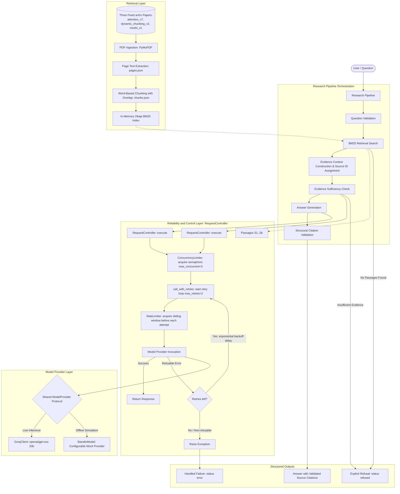
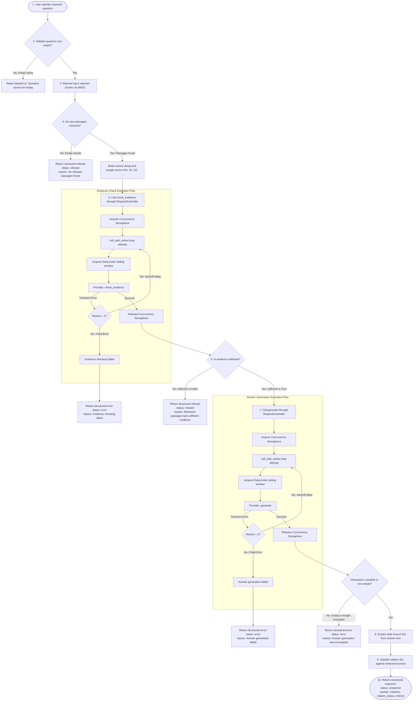

# Relay: Resilient RAG and LLM Control Pipeline

Relay is an experimental prototype of a fault-tolerant Retrieval-Augmented Generation (RAG) system for academic literature question answering. It investigates how to handle rate limits, concurrency ceilings, non-deterministic tail latencies, intermittent 5xx faults, and weak contextual evidence through explicit traffic control, multi-stage evidence checking, and structural citation verification.

The final assignment report is available in Markdown at [report/FINAL_REPORT.md](report/FINAL_REPORT.md) and in two-page A4 landscape PDF format at [report/FINAL_REPORT.pdf](report/FINAL_REPORT.pdf).

---

## System Architecture

The Relay system decouples document ingestion, lexical retrieval, pipeline orchestration, model execution, and traffic control. Incoming questions pass through the `ResearchPipeline`, which queries an Okapi BM25 index over three fixed arXiv research papers, coordinates remote or simulated inference through a centralized `RequestController` (enforcing concurrency limits, exponential backoff retries, and sliding-window rate limits), and performs two-stage evidence verification and citation validation.



---

## How It Works

The following workflow diagram illustrates the end-to-end request lifecycle and decision branching during query execution. The pipeline retrieves passages, builds citation identifiers (`[S1]`, `[S2]`), checks evidence sufficiency through the `RequestController`, generates an answer if evidence permits, and verifies that all cited identifiers structurally match retrieved passages.



---

## Core Components

### 1. Document Ingestion and Chunking (`app/retrieval/`)
- **Ingestion (`ingestion.py`)**: Parses PDF research papers page-by-page using PyMuPDF (`papers/attention_v7.pdf`, `papers/dynamic_chunking_v2.pdf`, `papers/moshi_v1.pdf`).
- **Chunking (`chunking.py`)**: Divides document text into overlapping **word-based chunks** (e.g. 250 words per chunk with 50-word overlap).
- **Retriever (`bm25_retriever.py`)**: Builds an in-memory Okapi BM25 index over tokenized chunks for fast lexical search.

### 2. Traffic Control and Resiliency (`app/control/`)
- **Request Controller (`request_controller.py`)**: Central coordinator wrapping calls through concurrency limits, rate limits, and retries.
- **Rate Limiter (`rate_limiter.py`)**: Thread-safe sliding-window rate limiter enforcing request frequencies (e.g. 25 requests per 60 seconds) by sleeping until capacity refreshes.
- **Concurrency Limiter (`concurrency.py`)**: Thread-safe bounded semaphore restricting parallel in-flight requests (default: 3 concurrent).
- **Retry Logic (`retry.py`)**: Exponential backoff retry handler for transient errors (`StandInError`, `StandInRateLimitError`, `RateLimitError`, `APITimeoutError`, `APIConnectionError`, `TimeoutError`, `ConnectionError`, and HTTP status codes 429, 500, 502, 503, 504). Deterministic errors (e.g. `ValueError`) fail immediately.

### 3. Model Providers (`app/providers/` and `standin/`)
- **Model Provider Protocol (`base.py`)**: Structural typing protocol declaring `generate()` and `check_evidence()`.
- **Groq Client (`groq_client.py`)**: Live API client using `GROQ_API_KEY` and configurable `GROQ_MODEL` (default: `openai/gpt-oss-20b`).
- **Configurable Stand-In Model (`standin/model.py`)**: Offline simulator with configurable latency (`latency_ms`), failure rate (`failure_rate`), synthetic rate limits (`rate_limit_every`), refusal behavior (`refusal_rate`), and token streaming. Stand-in runs represent client-side simulations and do not reproduce actual upstream Groq HTTP status headers, retry-after directives, or remote server-side scheduling queues.

### 4. End-to-End Orchestrator (`app/pipeline/`)
- **Research Pipeline (`research_pipeline.py`)**: Coordinates the multi-step lifecycle:
  1. Lexical retrieval of top-K chunks via BM25.
  2. Aggregates context with bracketed source identifiers (`[S1]`, `[S2]`).
  3. Evidence verification gate through `check_evidence()`. If insufficient, returns structured refusal (`status: "refused"`).
  4. Grounded answer generation using the retrieved passages.
  5. **Structural Citation Validation**: Checks whether all cited source IDs (`[S1]`, `[S2]`) actually exist in the retrieved passage set. It validates citation structural integrity, not semantic claim-to-source truth.

---

## Project Structure

```
Relay/
|-- app/
|   |-- control/
|   |   |-- concurrency.py         # Thread-safe concurrency semaphore
|   |   |-- rate_limiter.py        # Sliding-window rate limiter
|   |   |-- request_controller.py  # Resilient execution coordinator
|   |   +-- retry.py               # Exponential backoff retry handler
|   |-- pipeline/
|   |   +-- research_pipeline.py   # Multi-stage RAG orchestrator
|   |-- providers/
|   |   |-- base.py                # ModelProvider typing protocol
|   |   +-- groq_client.py         # Groq API client integration
|   +-- retrieval/
|       |-- bm25_retriever.py      # Okapi BM25 search engine
|       |-- chunking.py            # Word-based overlapping chunker
|       +-- ingestion.py           # Document extraction loader
|-- data/
|   |-- chunks.json                # Pre-built indexed corpus chunks (315 chunks)
|   +-- pages.json                 # Ingested PDF page documents (120 pages)
|-- evaluation/
|   +-- questions.json             # 15 benchmark questions across 4 categories
|-- papers/
|   |-- attention_v7.pdf           # Attention Is All You Need
|   |-- dynamic_chunking_v2.pdf    # Dynamic Chunking for RAG
|   +-- moshi_v1.pdf               # Moshi: Real-Time Audio Language Model
|-- report/
|   |-- FINAL_REPORT.md            # Final engineering report
|   +-- FINAL_REPORT.pdf           # Two-page rendered A4 landscape report
|-- results/
|   |-- results.csv                # Raw empirical test records (425 requests)
|   |-- retrieval_eval.csv         # Retrieval benchmark across settings A, B, C
|   +-- scenario_summary.csv       # Summary metrics generated from results.csv
|-- scripts/
|   |-- analyze_load_test.py       # Computes metrics summary from results.csv
|   |-- build_chunks.py            # Generates word-based chunks from pages.json
|   |-- evaluate_retrieval.py      # Runs retrieval benchmark on questions.json
|   |-- ingest.py                  # Extracts text pages from PDF papers
|   |-- inspect_scores.py          # Diagnostic query score inspector
|   |-- load_test.py               # Multi-scenario stand-in load test runner
|   |-- measure_groq.py            # Latency benchmark tool for Groq API
|   |-- search_chunks.py           # Interactive CLI query testing tool
|   |-- test_concurrency.py        # Unit test for parallel concurrency locks
|   |-- test_groq.py               # Integration test for Groq API
|   |-- test_pipeline.py           # End-to-end integration test (answerable & refusal)
|   |-- test_pipeline_retries.py   # Resiliency test with simulated flaky provider
|   |-- test_provider_interface.py # Protocol compatibility tests
|   |-- test_rate_limiter.py       # Sliding-window rate limit test
|   |-- test_request_controller.py # Combined controller test
|   |-- test_retry.py              # Unit tests for exponential backoff
|   +-- test_standin.py            # Unit tests for stand-in simulator
|-- standin/
|   |-- __init__.py
|   +-- model.py                   # Configurable offline mock provider
|-- .env.example                   # Sanitized environment template
|-- .gitignore                     # Git ignore rules (.env ignored)
|-- requirements.txt               # Python package dependencies
+-- README.md
```

---

## Setup and Installation

### 1. Prerequisites
- Python 3.12+
- Windows PowerShell (or bash on Linux/macOS)

### 2. Virtual Environment Setup
Clone the repository and set up a virtual environment:

```powershell
# Create virtual environment
python -m venv .venv

# Activate virtual environment (Windows PowerShell)
.\.venv\Scripts\Activate.ps1

# Install dependencies
pip install -r requirements.txt
```

### 3. Environment Configuration
Copy the provided environment template to `.env` and supply your Groq API key:

```powershell
Copy-Item .env.example .env
```

Edit `.env` locally:
```env
GROQ_API_KEY=your_actual_groq_api_key_here
GROQ_MODEL=openai/gpt-oss-20b
```

> **Note**: `.env` is ignored by Git and should never be committed.

---

## Reproducible Command Reference

Set `PYTHONPATH` before running scripts to ensure all modules resolve properly:

```powershell
$env:PYTHONPATH="."
```

### Offline Commands (No API Key Required)

1. **Document Ingestion**:
   Extracts text page-by-page from PDFs in `papers/` and outputs `data/pages.json`:
   ```powershell
   .\.venv\Scripts\python.exe scripts/ingest.py
   ```

2. **Word-Based Chunk Generation**:
   Generates overlapping word-based chunks from `data/pages.json` into `data/chunks.json`:
   ```powershell
   .\.venv\Scripts\python.exe scripts/build_chunks.py
   ```

3. **Retrieval Evaluation**:
   Evaluates BM25 retrieval across Settings A, B, and C against `evaluation/questions.json` and updates `results/retrieval_eval.csv`:
   ```powershell
   .\.venv\Scripts\python.exe scripts/evaluate_retrieval.py
   ```

4. **BM25 Score Diagnostics**:
   Inspects BM25 lexical scores for answerable vs unanswerable queries:
   ```powershell
   .\.venv\Scripts\python.exe scripts/inspect_scores.py
   ```

5. **Unit and Component Verification Tests**:
   ```powershell
   .\.venv\Scripts\python.exe scripts/test_standin.py
   .\.venv\Scripts\python.exe scripts/test_rate_limiter.py
   .\.venv\Scripts\python.exe scripts/test_concurrency.py
   .\.venv\Scripts\python.exe scripts/test_retry.py
   .\.venv\Scripts\python.exe scripts/test_request_controller.py
   .\.venv\Scripts\python.exe scripts/test_provider_interface.py
   .\.venv\Scripts\python.exe scripts/test_pipeline_retries.py
   ```

6. **Stand-In Load Testing**:
   Executes steady, burst, sustained overload, reduced-limit, and daily-budget simulations using `StandInModel` and appends records to `results/results.csv`:
   ```powershell
   .\.venv\Scripts\python.exe scripts/load_test.py
   ```

7. **Load Test Results Analysis**:
   Computes statistical latency quantiles (p50/p95/p99), reliability rates, retries, and token averages from `results/results.csv` into `results/scenario_summary.csv`:
   ```powershell
   .\.venv\Scripts\python.exe scripts/analyze_load_test.py
   ```

### Online Commands (Requires Valid `GROQ_API_KEY`)

1. **Groq Provider Integration Test**:
   Verifies direct inference and structured evidence checking against the live Groq endpoint:
   ```powershell
   .\.venv\Scripts\python.exe scripts/test_groq.py
   ```

2. **End-to-End Pipeline Execution**:
   Runs the complete retrieval, evidence checking, and grounded generation pipeline against live Groq for an answerable query and an unanswerable query:
   ```powershell
   .\.venv\Scripts\python.exe scripts/test_pipeline.py
   ```

3. **Live Latency Benchmark**:
   Runs sequential requests against live Groq to record baseline response times:
   ```powershell
   .\.venv\Scripts\python.exe scripts/measure_groq.py
   ```

---

## Experimental Findings Summary

### 1. Baseline vs Stand-In Load Testing Comparison

The real baseline contains **five sequential requests** against live Groq (`openai/gpt-oss-20b`). In non-streaming mode, first-token latency was not measured. Because this baseline consists of only five requests, its p95 (2,086.69 ms) and p99 (2,363.55 ms) values are descriptive observations from a very small sample and should not be treated as reliable tail-latency estimates.

The remaining scenarios are offline simulations using `StandInModel` to evaluate local queuing, concurrency bounds, and simulated quota behavior:
- In `hour9_reduced_limit_v1`, the test is a client-side rate-limiter simulation, not a real Groq HTTP 429 experiment. All 40 requests completed successfully with a p95 latency of approximately 61,140 ms; this delay was caused by client-side queueing as requests waited for the local 15-request/60-second sliding window to refresh. No actual upstream Groq rate-limit response was measured in this scenario.
- In `hour9_daily_budget_v1`, the model rejected requests after 5 successful calls, testing terminal failure handling after exhausting `max_retries=2`.

Derived from `results/results.csv` via `scripts/analyze_load_test.py`:

| Scenario | Source | Requests | Success (%) | Rate-Limited (%) | Total Latency p50 (ms) | Total Latency p95 (ms) | Total Latency p99 (ms) | Avg Retries |
|---|---|---|---|---|---|---|---|---|
| `baseline_sequential` | Real Groq | 5 | 100.0% | 0.0% | 572.59 | 2086.69 | 2363.55 | 0.00 |
| `hour9_steady_v2` | Stand-in | 60 | 100.0% | 0.0% | 573.74 | 575.49 | 575.89 | 0.00 |
| `hour9_burst` | Stand-in | 120 | 100.0% | 0.0% | 3154.31 | 5734.02 | 5734.80 | 0.00 |
| `hour9_sustained_overload` | Stand-in | 160 | 100.0% | 0.0% | 3104.92 | 5636.44 | 6057.19 | 0.00 |
| `hour9_reduced_limit_v1` | Stand-in | 40 | 100.0% | 0.0% | 2292.52 | 61140.12 | 61153.48 | 0.00 |
| `hour9_daily_budget_v1` | Stand-in | 20 | 25.0% | 75.0% | 2647.66 | 4900.15 | 4900.53 | 1.50 |

### 2. Retrieval Evaluation Benchmark

Evaluating chunking configurations across 120 ingested paper pages against 15 benchmark questions (`results/retrieval_eval.csv`):

| Setting | Chunk Size | Overlap | Top-K | Total Chunks | All Expected Papers Found | Expected-Term Coverage |
|---|---|---|---|---|---|---|
| Setting A | 250 words | 50 words | 3 | 315 | 11 / 13 (84.6%) | 92.31% |
| Setting B | 500 words | 50 words | 5 | 184 | 11 / 13 (84.6%) | 98.08% |
| Setting C | 800 words | 50 words | 5 | 122 | 12 / 13 (92.3%) | 100.00% |

- **Lexical Retrieval on Unanswerable Questions**: BM25 computes lexical similarity and returns high scores even for out-of-domain queries (e.g. *"What is the best Java programming course?"* returned a Moshi chunk scoring 13.0191 due to programming keywords). BM25 retrieval alone does not filter unanswerable questions.
- **Evidence Verification Refusal Gate**: The downstream `check_evidence` stage evaluates retrieved context against the question. In end-to-end tests (`scripts/test_pipeline.py`), out-of-domain queries (e.g. *"What is the current NVIDIA stock price?"*) were evaluated by the evidence gate, found insufficient (`sufficient: False`), and properly issued a structured refusal (`status: "refused"`).
